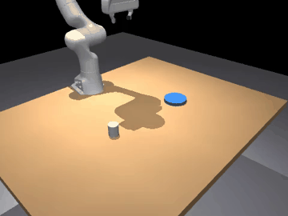
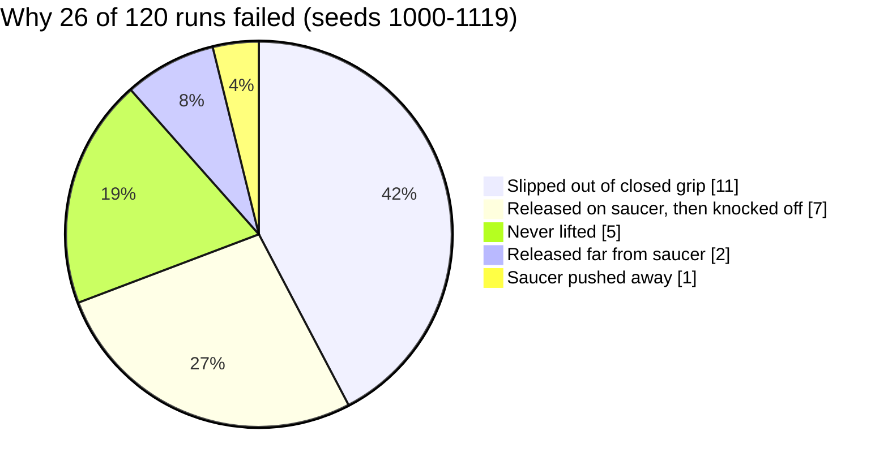

<div align="center">

# 🦾 UMI in MuJoCo

### A simulated robot arm learns to pick up a cup and place it on a saucer.<br>This is the full story: what worked, what failed, and how to pick it up from here.


<table>
<tr>
<td align="center"><br><sub>seed 1000</sub></td>
<td align="center"><br><sub>seed 1024</sub></td>
<td align="center"><br><sub>seed 1059</sub></td>
</tr>
</table>
<sub>Three different random layouts, all successes of the final controller.</sub>

[The story](#the-story-in-60-seconds) · [Results](#results) · [Videos](#videos) · [Journey](#our-journey) · [Mistakes](#mistakes-and-lessons) · [Reproduce](#reproduce) · [Repo map](#repository-map) · [Next steps](#what-to-do-next)

<table>
<tr>
<td align="center"><h2>82%</h2><sub>final success rate<br>492 of 600 episodes</sub></td>
<td align="center"><h2>60% → 78%</h2><sub>from one small fix<br>on the same 120 seeds</sub></td>
<td align="center"><h2>about 1 / 60</h2><sub>without the two<br>hand-tuned offsets</sub></td>
<td align="center"><h2>1,800</h2><sub>scripted demos<br>used for training</sub></td>
</tr>
</table>

<sub>Read time: about 10-15 minutes · Last updated: 27 Nov 2026</sub>

</div>

---

## The story in 60 seconds

We trained [UMI](https://umi-gripper.github.io/) (a diffusion-policy robot controller) inside a MuJoCo simulation to pick up a cup and put it on a saucer. Then we spent weeks finding out why it only half worked.

1. 🎓 **The policy learns the demos almost perfectly**, yet when it controls the robot on its own it fails about 59 times out of 60.
2. 🩹 **Two hand-tuned offsets rescue it**: +12 mm sideways and +12 mm up on the hand target. Why they are needed is **unknown**. This is the biggest open question.
3. 🎯 **One small change made the real difference.** Removing the upward offset *only during the final descent and grasp* took success from 60% to 78% on the same seeds, and to **82% over five fresh sets**.
4. 🚫 **Most other ideas did nothing**: retraining, extra data, retries, gates, finger changes. We list them so you do not repeat them.
5. 📦 **Everything is here**: code, logs behind every number, saved training settings, and our mistakes.

> [!IMPORTANT]
> This is **simulation only**. Nothing here has been tested on a real robot. See [Toward real hardware](#toward-real-hardware).

**Evidence labels used below:** *measured* = a number a real run printed · *likely* = reasoning we believe but did not prove · *unknown* = we do not know.

---

## The task

| | |
|---|---|
| **Goal** | Pick up the cup, place it on the saucer, let go without disturbing it, move away without pushing it |
| **Success means** | Cup within 3 cm of the saucer centre, resting on top, upright, and no longer held |
| **Simulator** | MuJoCo, Franka Panda arm with a wrist camera. Cup radius 2.5 cm, mass 0.1 kg. Layout is random every episode. Control at 50 Hz |
| **Training data** | 1,800 demonstrations from a scripted "expert" program (about 98-100% success) with random jitter and start poses |
| **Policy** | UMI diffusion U-Net (`DiffusionUnetTimmPolicy`, DDIM), 224 px images, no augmentation, batch 8, 10 epochs x 2,500 steps. Encoder is trained, not frozen |
| **Controller input** | Gripper width and hand pose only. **No simulator ground truth** (used only for diagnosis and scoring) |
| **Hardware** | One Ubuntu PC, RTX 3050 8 GB, which is why the batch size is only 8 |


---

## Results

All numbers are *measured*. Noise is about ±5 episodes out of 120. A gap of 10 or more is meaningful, and it should repeat on other seed sets.

### How we climbed (same 120 seeds, 1000-1119)

```text
No offsets, no fix          █░░░░░░░░░░░░░░░░░░░░░░░░░░░░░░░░░░░░░░░  1 / 60   (~2%)
Offsets, old behaviour      ████████████████████████░░░░░░░░░░░░░░░░  72 / 120 (60%)
Half nudge during grasp     ██████████████████████████████░░░░░░░░░░  91 / 120 (76%)
Fix: no nudge during grasp  ███████████████████████████████░░░░░░░░░  94 / 120 (78%)
Final, five fresh sets      █████████████████████████████████░░░░░░░  492 / 600 (82%)
```

Before all this, the policy alone scored about 25-35% on early test seeds, while the scripted expert scored about 100%.

### Final result: five sets of fresh seeds

| Fresh seeds | Success | Log |
|---|---|---|
| 1000-1119 | 94/120 (78%) | `results/logs/fresh_zg0.txt` |
| 2000-2119 | 87/120 (72.5%) | `results/logs/xb_0.012.txt` |
| 3000-3119 | 100/120 (83%) | `results/logs/xc_0.012_3000.txt` |
| 4000-4119 | 108/120 (90%) | `results/logs/xc_0.012_4000.txt` |
| 5000-5119 | 103/120 (86%) | `results/logs/handover_5000.txt` |

Sets swing a lot (72% to 90%), so quote **"about 80%" with the spread**, never one number. The fix and offset values were chosen on other seeds (160-279), so these five sets were not used for tuning.

<details>
<summary><b>The sideways offset has a narrow sweet spot</b> (click to open)</summary>

Out of 120 episodes per set, with the grasp fix on:

| `--xbias` | Seeds 2000 | Seeds 3000 | Seeds 4000 |
|---|---|---|---|
| 0.004 | 51 | | |
| 0.006 | 83 | | |
| 0.008 | 96 | 101 | 96 |
| **0.012 (kept)** | 87 | 100 | 108 |
| 0.016 | 54 | | |

0.008 and 0.012 tie overall (293 vs 295 of 360). Both ends of the range collapse, so the sweet spot is real.

</details>

### Why the remaining runs fail



The cup was lifted above 6 cm in 115 of 120 episodes, so grasping works most of the time. Failures depend on the layout, not luck: re-running a seed fails on nearly the same ones.

---

## Videos

Full-length clips of the final controller (they include the release and the retreat). Each seed is a different random layout. Click a name to play it.

| Seed | Clip |
|---|---|
| 1000 | [seed1000_success.mp4](results/videos/seed1000_success.mp4) |
| 1002 | [seed1002_success.mp4](results/videos/seed1002_success.mp4) |
| 1004 | [seed1004_success.mp4](results/videos/seed1004_success.mp4) |
| 1024 | [seed1024_success.mp4](results/videos/seed1024_success.mp4) |
| 1059 | [seed1059_success.mp4](results/videos/seed1059_success.mp4) |

---

## How the final controller works

The policy outputs a target position for the hand. Our controller adds two fixed offsets, then floors the height:

```text
target = policy output
height = max(target.z, 27 mm) + 12 mm      # floor first, then the upward offset
sideways = target.x + 12 mm
```

Because the floor is applied **before** the upward offset, the hand could **never be commanded below 39 mm** (27 + 12). The cup centre is at 30 mm and our scripted expert grasps at about 35 mm.

> [!TIP]
> **The fix** (`--zbias_grasp 0.0`): while the hand is below 8 cm with the gripper open, and until a grasp is detected, the upward offset is replaced by zero. After the grasp it ramps back to 12 mm over 30 steps. The median grasp height dropped to 23 mm, and 109 of 120 grasps were below 38 mm. That "the fingers were too high on the cup" is the *likely* reason it works; the result itself is measured.

---

## The model

| | |
|---|---|
| **Total size** | 171,273,610 parameters (about 171 million) |
| Image part | 85,799,424 (about 86 M). A pretrained CLIP ViT-B/16 (`vit_base_patch16_clip_224.openai`), trained, not frozen |
| Decision part | 85,474,186 (about 85 M). The diffusion U-Net that outputs the actions |
| It looks at | the last 2 steps of images and hand data |
| Plans / carries out | 16 steps ahead / 8 per decision |
| Diffusion steps | 50 in training, 16 when running |
| File | `final_policy.ckpt`, 1.3 GB |
| GPU memory while running | about 1 GB (477 to 1,518 MiB peak, read from `nvidia-smi` during evaluation) |
| Training time | about 4 hours on one RTX 3050 (measured on two later runs with the same recipe; the original run's own record is gone) |
| Fingerprint (sha256) | `a8745da8cfc344b6857c80da3d7d7a7db3e2f9f0f93e9f9587ff0862adafddd8` |

---

## Our journey

| When (2026) | What we did | What we learned | |
|---|---|---|---|
| Oct | Built the scene through setup notebooks. Recorded 1,800 expert demos. Trained on Colab, then on the lab PC. | The full pipeline works: scene, recording, training, evaluation. | ✅ |
| Late Oct - 4 Nov | First evaluations. | Policy alone 25-35% vs expert about 100%. Most failures at or after releasing the cup. | 🔎 |
| 5 Nov | Added a retreat after release (open, lift, back away) and tested its timing. | About 43% pooled. Retreat timing was not the cause (24-26/60 vs 28/60). | ❌ |
| 6 Nov | Tested offsets and gates. | Offsets are essential. Adding the 12 mm up-shift: 68/120 (57%) vs 51/120. Narrow sideways sweet spot (0.006: 19/120, 0.018: 37/120). Gates gave nothing. | 🔎 |
| 7 Nov | Forced the *expert* to grasp at different heights. Built DAgger (300 extra episodes from the policy's own situations). | Expert works at 28-40 mm, fails above about 45 mm. Policy failed more when closing high (36% below 45 mm, 71% at 55 mm or more). | 🔎 |
| 9-10 Nov | Retrained on DAgger data twice. | 63% and 66% on tuning seeds, 56% on fresh seeds. No real gain. | ❌ |
| 14 Nov | Checked how well the policy copies demos. | Very well: position error 0.58 cm vs 3.53 cm for "stay still". Imitation is not the problem. | 🔎 |
| 15 Nov | Tried arm-lag correction, retry-after-drop, and removing the up-shift at grasp only. | Lag correction 0/60. Retry: noise. **Removing the up-shift at grasp: 100/120 on tuning seeds.** | 🎯 |
| 19 Nov | Confirmed on four fresh sets. Documented and handed over. | **389/480 = 81%.** | ✅ |
| 27 Nov | Independent re-run for the handover on never-used seeds 5000-5119. | **103/120 (86%).** All five fresh sets: **492/600 = 82%.** | ✅ |

<sub>✅ milestone · 🔎 insight · ❌ no gain · 🎯 the breakthrough</sub>

---

## Mistakes and lessons

### Things we believed that turned out wrong

| We believed | Reality |
|---|---|
| The image encoder is frozen | Wrong, `freeze_encoder` is false |
| The sim-to-real gap explains the failures | Wrong, the demos come from this same simulator |
| The grip command dips and the cup slips | Refuted |
| The fingertip pads are too small | Not supported |
| DAgger data does not cover grasping and carrying | Wrong |
| Sideways offset 0.008 beats 0.012 | Only on one seed block. Overall they tie |
| Grasp height explains the remaining failures | Not supported (failures 39 mm vs successes 41 mm). An 8-episode comparison that suggested otherwise was a small-sample accident |
| Re-running a seed may end differently | Mostly it does not. The same seeds fail again |
| The finger-force column (`fn`) is evidence | Not reliable. Do not use it |

### Mistakes in how we worked

> [!WARNING]
> - **Tuning and judging on the same seeds.** Values chosen on tuning seeds were optimistic (83% there vs 78% on fresh seeds). Always confirm on seeds you never used.
> - **Quoting one number.** One fresh set said 78%. Five sets say 82%, ranging 72-90%.
> - **Big, expensive ideas first** (two retrains, DAgger rounds, gates) before looking closely at the moment of grasp. The real gain was a small controller change, not more training.
> - **Overstating causes.** We once wrote "about 35% of failures are because of the grasp" when the data only said "associated with".

### Practical slips that cost time
- Forgetting `source umi_env/bin/activate`: `python` is not found and chained commands silently print nothing.
- Disk full while merging DAgger data (the merged file is 12 GB). Check free space first.
- Running two GPU jobs at once.
- Expecting results mid-run (they print only when the run ends).

### Habits that worked (keep them)
- Never overwrite a script: write a patch script that creates the next `eval_simNN.py`.
- Never modify the baselines, the checkpoint, the base dataset, or the frozen copies.
- Fixed seed blocks, never reused.
- Judge by success counts on identical seeds, and call something an improvement only if it clearly beats the noise.

---

## Dead ends: do not retry

| Idea | Result |
|---|---|
| Correcting for arm tracking lag (`--trackfix`) | ❌ 0/60 |
| Retry after a dropped cup (`--regrasp`) | ❌ 71 vs 68 of 120 (noise). None of 31 re-grasps succeeded |
| Frame mismatch between camera and controller | ❌ none found in the code |
| Longer training (80k steps) | ❌ no gain |
| More DAgger rounds | ❌ 63% / 66% / 56%. Never tried with the new grasp fix |
| Height gating, stillness gating, taller pads, friction, 4x gripper force, squeeze threshold | ❌ no gain |
| Changing the sideways offset again | ❌ ties across three seed sets |
| Switching to a flat or square object | ❌ not justified |

---

## Reproduce

> [!NOTE]
> Our layout was `~/umi_mujoco/` with the UMI repo in `universal_manipulation_interface/` and our scripts in `sim/umi_sim/`. Copy `code/*.py` into `sim/umi_sim/` and run from `sim/`. Some scripts and saved configs contain absolute paths from the original machine (`/home/iitgn/umi_mujoco/...`). Change them to yours.

<details>
<summary><b>1. Setup</b></summary>

1. Ubuntu, Python 3.9, torch 2.1.0+cu121, mujoco 3.2.3 (full list in `env/requirements.txt`).
2. Clone UMI at the commit in `env/umi_repo_commit.txt`, then apply `code/umi_repo_patch.diff`.
3. Franka model: MuJoCo Menagerie `franka_emika_panda`, expected at `sim/mujoco_menagerie/franka_emika_panda`.
4. Every time, before anything else:

```bash
source ~/umi_mujoco/umi_env/bin/activate
export MUJOCO_GL=egl PYOPENGL_PLATFORM=egl
```

</details>

<details>
<summary><b>2. Get the trained model</b></summary>

Download `final_policy.ckpt` (1.3 GB): **[final_policy.ckpt (GitHub Release v1.0)](https://github.com/ayushi2577/UMI---Cup-Arrangement-/releases/download/v1.0/final_policy.ckpt)**. Put it at `~/umi_mujoco/final_results/final_policy.ckpt`.

</details>

<details open>
<summary><b>3. Reproduce the result (the final command)</b></summary>

```bash
CK=~/umi_mujoco/final_results/final_policy.ckpt
python umi_sim/eval_sim19.py --ckpt $CK --lead 6 --xbias 0.012 --zbias 0.012 --zbias_grasp 0.0 \
  --trace --retreat --xbias_mode pregrasp --glead 0 --rt_trig 0.055 --rt_full 0.078 --rt_back -0.10 \
  --n 120 --start_seed 1000 > ~/umi_mujoco/exp/NAME.txt 2>&1
grep -c '^GTX [0-9]* success' ~/umi_mujoco/exp/NAME.txt
```

About 7 minutes per 120 episodes. Result lines appear only when the run finishes, so a count of 0 mid-run is normal. Repeat with `--start_seed 2000`, `3000`, `4000` and expect roughly 94, 87, 100, 108 (within noise). Runs are not bitwise reproducible. Add `--videos N --video_full` for full clips and `--reltrace` for a per-step csv.

</details>

<details>
<summary><b>4. Reproduce the baselines</b></summary>

- **Old setting (60%):** the same command without `--zbias_grasp 0.0`, seeds 1000-1119. Expect about 72/120.
- **No offsets (about 1/60):** the same command with `--xbias 0 --zbias 0` (*likely* how we ran it; check `results/logs`).
- **Anything new:** use seeds 5000 and above. Earlier blocks were used for tuning or confirmation.

</details>

<details>
<summary><b>5. Retrain the policy</b></summary>

The original training command was not saved. These settings were recovered from the checkpoint itself (`docs/final_policy_training_config.yaml`): dataset `cup_sim_v2.zarr.zip`, batch 8, learning rate 0.0003, cosine schedule, 500 warmup steps, 10 epochs, 2,500 steps per epoch, encoder not frozen, no image augmentation. The command below is **rebuilt**: those settings are confirmed, the other flags are copied from our later DAgger runs. Run it from the UMI repo:

```bash
python train.py --config-name=train_diffusion_unet_timm_umi_workspace \
  task.dataset_path=<path>/cup_sim_v2.zarr.zip \
  dataloader.batch_size=8 val_dataloader.batch_size=8 dataloader.num_workers=2 val_dataloader.num_workers=1 \
  logging.mode=disabled training.rollout_every=100000 training.num_epochs=10 training.max_train_steps=2500 \
  training.max_val_steps=100 training.checkpoint_every=1 training.lr_scheduler=cosine training.lr_warmup_steps=500 \
  policy.obs_encoder.transforms=null checkpoint.topk.k=3
```

Training loss tells you little. **Judge a policy only by running it.**

</details>

<details>
<summary><b>6. Regenerate the demos</b> (8 GB, not included)</summary>

Run `code/record_demos_v2.py` to produce `cup_sim_v2.zarr.zip` (1,800 episodes). Its arguments are not documented yet; read the top of the script. *Unknown:* what changed in `scene.py` on 2 Nov.

</details>

---

## Repository map

| You want | Look at |
|---|---|
| **Evaluation (final)** | `code/eval_sim19.py` |
| Evaluation history (each file was made by patching the previous one) | `code/eval_sim.py` ... `eval_sim19.py`, patch scripts `code/history/make_eval_sim2.py` ... `make_eval_sim14.py` and `code/make_eval_sim15.py` ... `make_eval_sim19.py` |
| **Training** | Not our own code. We use UMI's `train.py`. Command and settings: [Reproduce, step 5](#reproduce) and `docs/final_policy_training_config.yaml` |
| The one change we made inside UMI | `code/umi_repo_patch.diff` (learning-rate scheduler horizon) |
| Simulation scene and environment | `code/scene.py`, `code/env.py` (`UmiSimEnv`) |
| Scripted expert and demo recording | `code/expert.py`, `code/expert2.py` (used for demos), `code/record_demos_v2.py` |
| DAgger experiments | `code/record_dagger.py`, `code/merge_dagger.py`, `docs/training_commands_dagger.txt` |
| Analysis helper | `code/rt_summary.py` (per-seed table from the per-step trace) |
| Diagnostic scripts (unpolished, kept for reference) | `code/diagnostics/` (for example `expert_height_test.py`, `lead_trace.py`, `release_diag.py`) |
| Our comparison with the official UMI setup | `docs/official_vs_ours.md` |
| Logs behind every number | `results/logs/` |
| Success videos | `results/videos/` |
| Saved training settings | `docs/final_policy_training_config.yaml`, `docs/training_configs/` |
| Software versions | `env/requirements.txt`, `env/python_version.txt`, `env/umi_repo_commit.txt` |
| Trained model | Not in git (1.3 GB). Link in [Reproduce, step 2](#reproduce) |
| Earlier setup notebooks | Removed from the current tree, still in git history |

`eval_sim.py` and `eval_sim3.py` are untouched baselines. Never edit them. New ideas go in a new `eval_sim20.py`.

---

## What to do next

If you are picking this up, here is where we would start, most valuable first:

1. **Why does the policy need the offsets at all?** It copies demos almost perfectly, yet fails without them. Unexplained. Solving this properly matters more than any further tuning.
2. **Confirm the off-centre grip lead.** In a 60-episode trace, closing the gripper 10 mm or more off the cup centre went with high failure (7 of 11 failed vs 5 of 49 otherwise). The 10 mm line was chosen after looking at the data and n is small. Run seeds 5000+ with `--reltrace`, then `python umi_sim/rt_summary.py NAME.txt`.
3. **A crooked-grip check.** In the 7 carry failures the finger gap was already narrow (45-48 mm) as the cup left the table, against 49.4 mm normally. The robot could notice, put the cup down and retry *before* lifting. This differs from `--regrasp`, which only reacted after the cup had fallen.
4. **Fade the sideways offset just before closing,** so the hand lands closer to the cup centre. A gamble, since whole-run changes did not help.
5. **Try `--zbias_grasp 0.0` on the DAgger policies.** No retraining needed.

---

## Toward real hardware

> [!CAUTION]
> Everything below is opinion. Nothing in this repo was tested on a real robot.

UMI was built for real robots, and our controller uses only gripper width and hand pose, which a real robot can provide. But:
- The two offsets were tuned for **this** simulator and their cause is unknown. Expect to re-tune them, or better, find the real cause first.
- Camera images here are rendered at 224 px. Real cameras differ in lighting, colour and delay.
- Camera calibration, a robot interface and a real gripper do not exist in this repo.
- Real cups and tables have different friction and mass than ours.

---

## Credits

Built on [UMI](https://umi-gripper.github.io/) (real-stanford/universal_manipulation_interface). Franka model from MuJoCo Menagerie.

**Authors and contact:** Ayushi Agrawal (@ayushi2577), Shivani Srivastava (@shivanisrivastava-01) · **License:** Not yet decided