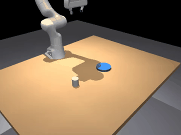
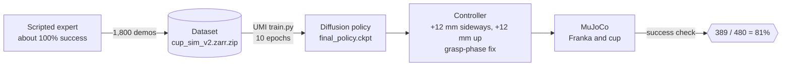
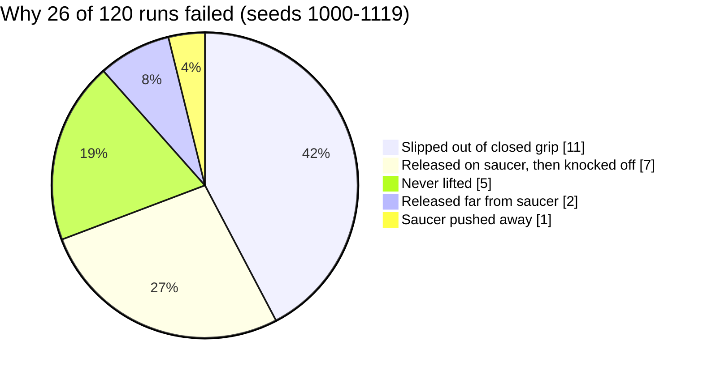
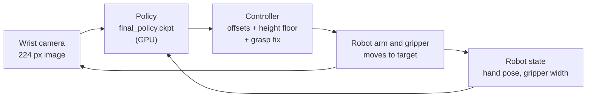

# 🦾 UMI in MuJoCo

### A simulated robot arm learns to pick up a cup and place it on a saucer. This is the full story: what worked, what failed, and how to pick it up from here.

    

| | | |
|---|---|---|
|  |  |  |
| seed 1000 | seed 1024 | seed 1059 |

Three different random layouts, all successes of the final controller.

[The story](#the-story-in-60-seconds) · [Glossary](#glossary-plain-words) · [Task](#the-task) · [Model size](#model-size) · [Results](#results) · [Videos](#videos) · [Journey](#our-journey) · [Mistakes](#mistakes-and-lessons) · [Unknowns](#known-unknowns) · [Reproduce](#reproduce) · [Repo map](#repository-map) · [Next steps](#what-to-do-next) · [Hardware handover](#hardware-handover)

## 81%
final success rate, 389 of 480 episodes

## 60% → 78%
from one small fix, on the same 120 seeds

## about 1 / 60
without the two hand-tuned offsets

## 1,800
scripted demos used for training

Read time: about 15 minutes · Last updated: 24 Nov 2026

---

## The story in 60 seconds

We trained [UMI](https://umi-gripper.github.io/) (a diffusion-policy robot controller) inside a MuJoCo simulation to pick up a cup and put it on a saucer. Then we spent weeks finding out why it only half worked.

1. 🎓 **The policy learns the demos almost perfectly**, yet when it controls the robot on its own it fails about 59 times out of 60.
2. 🩹 **Two hand-tuned offsets rescue it**: +12 mm sideways and +12 mm up on the hand target. Why they are needed is **unknown**. This is the biggest open question.
3. 🎯 **One small change made the real difference.** Removing the upward offset *only during the final descent and grasp* took success from 60% to 78% on the same seeds, and to **81% over four fresh sets**.
4. 🚫 **Most other ideas did nothing**: retraining, extra data, retries, gates, finger changes. We list them so you do not repeat them.
5. 📦 **Everything is here**: code, logs behind every number, saved training settings, and our mistakes.

> [!IMPORTANT]
> This is **simulation only**. Nothing here has been tested on a real robot. See the [Hardware handover](#hardware-handover) guide.

**Evidence labels used below:** *measured* = a number a real run printed · *likely* = reasoning we believe but did not prove · *unknown* = we do not know.

**New here? Read in this order:** the story above, the [Glossary](#glossary-plain-words), [Known unknowns](#known-unknowns), then [Reproduce](#reproduce). If your goal is a real robot, finish with the [Hardware handover](#hardware-handover).

---

## Glossary (plain words)

| Word | What it means here |
|---|---|
| **Policy** | The trained "brain". It looks at the camera image and the robot's hand state, and decides where the hand should move next. |
| **Checkpoint** (`.ckpt`) | A saved copy of the trained brain in a single file. `final_policy.ckpt` is the one that gives the 81%. |
| **Demonstration (demo)** | One example of the task done correctly. Here they come from a scripted "expert" program, not a human. |
| **Imitation learning** | Teaching the policy by showing it many demos and asking it to copy them. |
| **Diffusion policy** | A type of policy that builds its answer (a short path for the hand) step by step, starting from noise. UMI uses this. |
| **DAgger** | A trick to improve a policy: let the policy drive, record the situations where it gets into trouble, and add expert corrections for those situations to the training data. We tried it. It did not help much. |
| **Episode** | One full attempt at the task, from start to success or failure. |
| **Seed** | A number that fixes the random layout (where the cup and saucer start). The same seed always gives the same layout, so two versions can be compared fairly. |
| **Seed block** | A range of seeds used together, e.g. 1000-1119. Never reuse a block that was used for tuning when you judge a final result. |
| **Offset** (`--xbias`, `--zbias`) | A fixed nudge added to the hand target the policy asks for (+12 mm sideways, +12 mm up). Needed for the policy to work in simulation, and nobody knows why. |
| **Grasp fix** (`--zbias_grasp 0.0`) | Switching the upward offset off while the hand is lowering onto the cup. This lifted success from 60% to 78%. |
| **Hand pose / TCP** | Where the robot's hand (the point between the fingers) is, and how it is rotated. |
| **Gripper width** | How far apart the two fingers are. |
| **Wrist camera** | The camera mounted on the robot hand. Its image is the policy's "eyes". |
| **Sim-to-real gap** | The differences between simulation and real life (lighting, friction, delays) that can make a policy fail on a real robot. |
| **Ground truth** | Exact information only the simulator knows (e.g. the true cup position). Used for scoring only, never given to the controller. |

---

## The task

| | |
|---|---|
| **Goal** | Pick up the cup, place it on the saucer, let go without disturbing it, move away without pushing it |
| **Success means** | Cup within 3 cm of the saucer centre, resting on top, upright, and no longer held |
| **Simulator** | MuJoCo, Franka Panda arm with a wrist camera. Cup radius 2.5 cm, mass 0.1 kg. Layout is random every episode. Control at 50 Hz |
| **Training data** | 1,800 demonstrations from a scripted "expert" program (about 98-100% success) with random jitter and start poses |
| **Policy** | UMI diffusion U-Net (`DiffusionUnetTimmPolicy`, DDIM), 224 px images, no augmentation, batch 8, 10 epochs x 2,500 steps. Encoder is trained, not frozen |
| **Controller input** | Gripper width and hand pose only. **No simulator ground truth** (used only for diagnosis and scoring) |
| **Hardware** | One Ubuntu PC, RTX 3050 8 GB, which is why the batch size is only 8 |



---

## Model size

How big the trained policy is. Values marked **FILL FROM LAB** were not recorded yet: read them from the checkpoint on the lab PC with `code/inspect_checkpoint.py` (see the box under the table) and paste the numbers here.

| Item | Value | How to get it |
|---|---|---|
| Policy type | UMI diffusion U-Net with a timm image encoder (`DiffusionUnetTimmPolicy`), DDIM sampling | known, from the saved config |
| Checkpoint file size | 1.3 GB (*likely* much larger than the network itself, because it also stores training extras such as the optimizer and a second averaged copy of the weights) | known |
| **Total parameters** | **FILL FROM LAB** (millions) | `inspect_checkpoint.py` |
| Image encoder part | **FILL FROM LAB** (millions) | `inspect_checkpoint.py` |
| Diffusion (decision) part | **FILL FROM LAB** (millions) | `inspect_checkpoint.py` |
| Weights size on disk (fp32) | **FILL FROM LAB** MB (parameters x 4 bytes) | `inspect_checkpoint.py` |
| Image encoder backbone name | **FILL FROM LAB** | `docs/final_policy_training_config.yaml` |
| Image input size | 224 x 224 px, no augmentation | known |
| Number of past frames used as input | **FILL FROM LAB** | config (`n_obs_steps`) |
| Other inputs | gripper width, hand pose (exact fields: **FILL FROM LAB**) | config / dataset shapes |
| Prediction length (future steps predicted at once) | **FILL FROM LAB** | config (`horizon`) |
| Steps actually executed before predicting again | **FILL FROM LAB** | config (`n_action_steps`) |
| Diffusion steps at run time | **FILL FROM LAB** (DDIM) | config (`noise_scheduler`, `num_inference_steps`) |
| Time for one policy decision on the RTX 3050 | **FILL FROM LAB** ms | time one call inside `eval_sim19.py` |
| GPU memory while running the policy | **FILL FROM LAB** GB | `nvidia-smi` during an eval run |
| Training: batch size, learning rate, schedule | 8, 0.0003, cosine with 500 warm-up steps | known |
| Training: length | 10 epochs x 2,500 steps = 25,000 steps | known |
| Training: wall-clock time | **FILL FROM LAB** hours | note from the run folder timestamps |
| Training data | 1,800 demos, `cup_sim_v2.zarr.zip` (about 8 GB) | known |

> **How to fill the table (about 2 minutes on the lab PC).** Activate the environment, then run:
>
> ```
> python code/inspect_checkpoint.py ~/umi_mujoco/final_results/final_policy.ckpt
> ```
>
> It prints the parameter counts, the split between image part and decision part, and the key sizes from the config. Paste the printed numbers into the table above.

---

## Results

All numbers are *measured*. Noise is about ±5 episodes out of 120. A gap of 10 or more is meaningful, and it should repeat on other seed sets.

### How we climbed (same 120 seeds, 1000-1119)

```
No offsets, no fix          █░░░░░░░░░░░░░░░░░░░░░░░░░░░░░░░░░░░░░░░  1 / 60   (~2%)
Offsets, old behaviour      ████████████████████████░░░░░░░░░░░░░░░░  72 / 120 (60%)
Half nudge during grasp     ██████████████████████████████░░░░░░░░░░  91 / 120 (76%)
Fix: no nudge during grasp  ███████████████████████████████░░░░░░░░░  94 / 120 (78%)
Final, four fresh sets      ████████████████████████████████░░░░░░░░  389 / 480 (81%)
```

Before all this, the policy alone scored about 25-35% on early test seeds, while the scripted expert scored about 100%.

### Final result: four sets of fresh seeds

| Fresh seeds | Success | Log |
|---|---|---|
| 1000-1119 | 94/120 (78%) | `results/logs/fresh_zg0.txt` |
| 2000-2119 | 87/120 (72.5%) | `results/logs/xb_0.012.txt` |
| 3000-3119 | 100/120 (83%) | `results/logs/xc_0.012_3000.txt` |
| 4000-4119 | 108/120 (90%) | `results/logs/xc_0.012_4000.txt` |

Sets swing a lot (72% to 90%), so quote **"about 80%" with the spread**, never one number. The fix and offset values were chosen on other seeds (160-279), so these four sets were not used for tuning.

<details>
<summary><b>The sideways offset has a narrow sweet spot (click to open)</b></summary>

Out of 120 episodes per set, with the grasp fix on:

| `--xbias` | Seeds 2000 | Seeds 3000 | Seeds 4000 |
|---|---|---|---|
| 0.004 | 51 | | |
| 0.006 | 83 | | |
| 0.008 | 96 | 101 | 96 |
| **0.012 (kept)** | 87 | 100 | 108 |
| 0.016 | 54 | | |

0.008 and 0.012 tie overall (293 vs 295 of 360). Both ends of the range collapse, so the sweet spot is real.

</details>

### Why the remaining runs fail



The cup was lifted above 6 cm in 115 of 120 episodes, so grasping works most of the time. Failures depend on the layout, not luck: re-running a seed fails on nearly the same ones.

---

## Videos

Full-length clips of the final controller (they include the release and the retreat). Each seed is a different random layout. Click a name to play it.

| Seed | Clip |
|---|---|
| 1000 | [seed1000_success.mp4](results/videos/seed1000_success.mp4) |
| 1002 | [seed1002_success.mp4](results/videos/seed1002_success.mp4) |
| 1004 | [seed1004_success.mp4](results/videos/seed1004_success.mp4) |
| 1024 | [seed1024_success.mp4](results/videos/seed1024_success.mp4) |
| 1059 | [seed1059_success.mp4](results/videos/seed1059_success.mp4) |

---

## How the final controller works

The policy outputs a target position for the hand. Our controller adds two fixed offsets, then floors the height:

```
target = policy output
height = max(target.z, 27 mm) + 12 mm      # floor first, then the upward offset
sideways = target.x + 12 mm
```

Because the floor is applied **before** the upward offset, the hand could **never be commanded below 39 mm** (27 + 12). The cup centre is at 30 mm and our scripted expert grasps at about 35 mm.

> [!TIP]
> **The fix** (`--zbias_grasp 0.0`): while the hand is below 8 cm with the gripper open, and until a grasp is detected, the upward offset is replaced by zero. After the grasp it ramps back to 12 mm over 30 steps. The median grasp height dropped to 23 mm, and 109 of 120 grasps were below 38 mm. That "the fingers were too high on the cup" is the *likely* reason it works; the result itself is measured.

---

## Our journey

| When (2026) | What we did | What we learned | |
|---|---|---|---|
| Oct | Built the scene through setup notebooks. Recorded 1,800 expert demos. Trained on Colab, then on the lab PC. | The full pipeline works: scene, recording, training, evaluation. | ✅ |
| Late Oct - 4 Nov | First evaluations. | Policy alone 25-35% vs expert about 100%. Most failures at or after releasing the cup. | 🔎 |
| 5 Nov | Added a retreat after release (open, lift, back away) and tested its timing. | About 43% pooled. Retreat timing was not the cause (24-26/60 vs 28/60). | ❌ |
| 6 Nov | Tested offsets and gates. | Offsets are essential. Adding the 12 mm up-shift: 68/120 (57%) vs 51/120. Narrow sideways sweet spot (0.006: 19/120, 0.018: 37/120). Gates gave nothing. | 🔎 |
| 7 Nov | Forced the *expert* to grasp at different heights. Built DAgger (300 extra episodes from the policy's own situations). | Expert works at 28-40 mm, fails above about 45 mm. Policy failed more when closing high (36% below 45 mm, 71% at 55 mm or more). | 🔎 |
| 9-10 Nov | Retrained on DAgger data twice. | 63% and 66% on tuning seeds, 56% on fresh seeds. No real gain. | ❌ |
| 14 Nov | Checked how well the policy copies demos. | Very well: position error 0.58 cm vs 3.53 cm for "stay still". Imitation is not the problem. | 🔎 |
| 15 Nov | Tried arm-lag correction, retry-after-drop, and removing the up-shift at grasp only. | Lag correction 0/60. Retry: noise. **Removing the up-shift at grasp: 100/120 on tuning seeds.** | 🎯 |
| 19 Nov | Confirmed on four fresh sets. Documented and handed over. | **389/480 = 81%.** | ✅ |

✅ milestone · 🔎 insight · ❌ no gain · 🎯 the breakthrough

---

## Mistakes and lessons

### Things we believed that turned out wrong

| We believed | Reality |
|---|---|
| The image encoder is frozen | Wrong, `freeze_encoder` is false |
| The sim-to-real gap explains the failures | Wrong, the demos come from this same simulator |
| The grip command dips and the cup slips | Refuted |
| The fingertip pads are too small | Not supported |
| DAgger data does not cover grasping and carrying | Wrong |
| Sideways offset 0.008 beats 0.012 | Only on one seed block. Overall they tie |
| Grasp height explains the remaining failures | Not supported (failures 39 mm vs successes 41 mm). An 8-episode comparison that suggested otherwise was a small-sample accident |
| Re-running a seed may end differently | Mostly it does not. The same seeds fail again |
| The finger-force column (`fn`) is evidence | Not reliable. Do not use it |

### Mistakes in how we worked

> [!WARNING]
> - **Tuning and judging on the same seeds.** Values chosen on tuning seeds were optimistic (83% there vs 78% on fresh seeds). Always confirm on seeds you never used.
> - **Quoting one number.** One fresh set said 78%. Four sets say 81%, ranging 72-90%.
> - **Big, expensive ideas first** (two retrains, DAgger rounds, gates) before looking closely at the moment of grasp. The real gain was a small controller change, not more training.
> - **Overstating causes.** We once wrote "about 35% of failures are because of the grasp" when the data only said "associated with".

### Practical slips that cost time

- Forgetting `source umi_env/bin/activate`: `python` is not found and chained commands silently print nothing.
- Disk full while merging DAgger data (the merged file is 12 GB). Check free space first.
- Running two GPU jobs at once.
- Expecting results mid-run (they print only when the run ends).

### Habits that worked (keep them)

- Never overwrite a script: write a patch script that creates the next `eval_simNN.py`.
- Never modify the baselines, the checkpoint, the base dataset, or the frozen copies.
- Fixed seed blocks, never reused.
- Judge by success counts on identical seeds, and call something an improvement only if it clearly beats the noise.

---

## Dead ends: do not retry

| Idea | Result |
|---|---|
| Correcting for arm tracking lag (`--trackfix`) | ❌ 0/60 |
| Retry after a dropped cup (`--regrasp`) | ❌ 71 vs 68 of 120 (noise). None of 31 re-grasps succeeded |
| Frame mismatch between camera and controller | ❌ none found in the code |
| Longer training (80k steps) | ❌ no gain |
| More DAgger rounds | ❌ 63% / 66% / 56%. Never tried with the new grasp fix |
| Height gating, stillness gating, taller pads, friction, 4x gripper force, squeeze threshold | ❌ no gain |
| Changing the sideways offset again | ❌ ties across three seed sets |
| Switching to a flat or square object | ❌ not justified |

---

## Known unknowns

Things nobody on the project knows or recorded. If you find the answer to any of these, write it here.

| # | Unknown | Why it matters | Where to start looking |
|---|---|---|---|
| 1 | **Why the policy needs the +12 mm sideways and +12 mm up offsets.** It copies the demos almost perfectly (0.58 cm error) but without the offsets it succeeds about 1 time in 60. | Biggest open question. On a real robot the offsets will need re-tuning, and the real cause may be a hidden mismatch (timing, frames, controller lag) that would show up there too. | Compare, step by step, what the demo recorder logs against what the evaluation controller commands. Check timing and the hand-pose frame. Tracking-lag correction (`--trackfix`) already failed. |
| 2 | **What changed in `scene.py` on 2 Nov.** | The demos in `cup_sim_v2.zarr.zip` may have been recorded with a slightly different scene than the current `scene.py`. | Look for older copies of `scene.py` on the lab PC, and in the git history and Colab notebooks. Ask whoever worked on the scene. |
| 3 | **The exact training command.** It was not saved. The settings were recovered from the checkpoint (`docs/final_policy_training_config.yaml`) and the command in Reproduce step 5 is *rebuilt*, not original. | A retrain may not give exactly the same policy. | Terminal history (`history \| grep train`), UMI `data/outputs/` run folders, Colab notebook history. |
| 4 | **How `record_demos_v2.py` is called.** Its arguments are not documented. | Needed to regenerate the 1,800 demos (8 GB, not in this repo). | Read the top of the script. |
| 5 | **The exact command for the "no offsets" baseline (about 1/60).** Written as *likely*. | Needed to repeat the baseline. | `results/logs`. |
| 6 | **Which scripted-expert settings produced the demo jitter and start poses.** | Needed to regenerate similar data. | `code/expert2.py`, `code/record_demos_v2.py`. |
| 7 | **Anything about real hardware.** Nothing was tested. | The whole [Hardware handover](#hardware-handover) section is untested advice. | Start with the step-by-step plan there. |
| 8 | **Model size, speed and memory numbers.** Not recorded yet. | Needed to choose the computer that runs the policy on the robot. | See [Model size](#model-size). |

---

## Reproduce

### Before you start: checklist

Make sure you have all of these in hand. If something is missing, the step that needs it is shown.

- [ ] **A Linux PC with an NVIDIA GPU.** We used Ubuntu with an RTX 3050 8 GB (batch size 8 is set by this card). Running the evaluation needs a GPU. Allow about 7 minutes per 120 episodes.
- [ ] **About 40 GB of free disk space** if you want to rebuild the data (demos about 8 GB, DAgger-merged file 12 GB). Check with `df -h` first. A full disk broke a merge once.
- [ ] **Python 3.9, torch 2.1.0+cu121, mujoco 3.2.3.** Full list in `env/requirements.txt`.
- [ ] **The UMI code at the right version.** Clone `real-stanford/universal_manipulation_interface` at the commit written in `env/umi_repo_commit.txt`, then apply `code/umi_repo_patch.diff`.
- [ ] **The Franka robot model.** MuJoCo Menagerie `franka_emika_panda`, expected at `sim/mujoco_menagerie/franka_emika_panda`.
- [ ] **The trained policy `final_policy.ckpt`** (1.3 GB, not in git). Link in step 2 below. Needed for every evaluation.
- [ ] **The training data `cup_sim_v2.zarr.zip`** (about 8 GB, not in git). Needed only to retrain. It can be rebuilt with `code/record_demos_v2.py`, but see [Known unknowns](#known-unknowns) #2 and #4.
- [ ] **This repo's `code/*.py`** copied into `sim/umi_sim/`.
- [ ] **Your own seed block** (5000 and above) for any new test. Blocks below that were already used.
- [ ] **A terminal with the environment active** (the two commands at the end of step 1). Forgetting this is the most common reason for "nothing prints".

> **Our layout:** `~/umi_mujoco/` with the UMI repo in `universal_manipulation_interface/` and our scripts in `sim/umi_sim/`. Copy `code/*.py` into `sim/umi_sim/` and run from `sim/`. Some scripts and saved configs contain absolute paths from the original machine (`/home/iitgn/umi_mujoco/...`). Change them to yours.

**1. Setup**

1. Ubuntu, Python 3.9, torch 2.1.0+cu121, mujoco 3.2.3 (full list in `env/requirements.txt`).
2. Clone UMI at the commit in `env/umi_repo_commit.txt`, then apply `code/umi_repo_patch.diff`.
3. Franka model: MuJoCo Menagerie `franka_emika_panda`, expected at `sim/mujoco_menagerie/franka_emika_panda`.
4. Every time, before anything else:

```
source ~/umi_mujoco/umi_env/bin/activate
export MUJOCO_GL=egl PYOPENGL_PLATFORM=egl
```

**2. Get the trained model**

Download `final_policy.ckpt` (1.3 GB): **(ADD LINK HERE)**. Put it at `~/umi_mujoco/final_results/final_policy.ckpt`.

**3. Reproduce the 81% (the final command)**

```
CK=~/umi_mujoco/final_results/final_policy.ckpt
python umi_sim/eval_sim19.py --ckpt $CK --lead 6 --xbias 0.012 --zbias 0.012 --zbias_grasp 0.0 \
  --trace --retreat --xbias_mode pregrasp --glead 0 --rt_trig 0.055 --rt_full 0.078 --rt_back -0.10 \
  --n 120 --start_seed 1000 > ~/umi_mujoco/exp/NAME.txt 2>&1
grep -c '^GTX [0-9]* success' ~/umi_mujoco/exp/NAME.txt
```

About 7 minutes per 120 episodes. Result lines appear only when the run finishes, so a count of 0 mid-run is normal. Repeat with `--start_seed 2000`, `3000`, `4000` and expect roughly 94, 87, 100, 108 (within noise). Runs are not bitwise reproducible. Add `--videos N --video_full` for full clips and `--reltrace` for a per-step csv.

**4. Reproduce the baselines**

- **Old setting (60%):** the same command without `--zbias_grasp 0.0`, seeds 1000-1119. Expect about 72/120.
- **No offsets (about 1/60):** the same command with `--xbias 0 --zbias 0` (*likely* how we ran it; check `results/logs`).
- **Anything new:** use seeds 5000 and above. Earlier blocks were used for tuning or confirmation.

**5. Retrain the policy**

The original training command was not saved. These settings were recovered from the checkpoint itself (`docs/final_policy_training_config.yaml`): dataset `cup_sim_v2.zarr.zip`, batch 8, learning rate 0.0003, cosine schedule, 500 warmup steps, 10 epochs, 2,500 steps per epoch, encoder not frozen, no image augmentation. The command below is **rebuilt**: those settings are confirmed, the other flags are copied from our later DAgger runs. Run it from the UMI repo:

```
python train.py --config-name=train_diffusion_unet_timm_umi_workspace \
  task.dataset_path=<path>/cup_sim_v2.zarr.zip \
  dataloader.batch_size=8 val_dataloader.batch_size=8 dataloader.num_workers=2 val_dataloader.num_workers=1 \
  logging.mode=disabled training.rollout_every=100000 training.num_epochs=10 training.max_train_steps=2500 \
  training.max_val_steps=100 training.checkpoint_every=1 training.lr_scheduler=cosine training.lr_warmup_steps=500 \
  policy.obs_encoder.transforms=null checkpoint.topk.k=3
```

Training loss tells you little. **Judge a policy only by running it.**

**6. Regenerate the demos (8 GB, not included)**

Run `code/record_demos_v2.py` to produce `cup_sim_v2.zarr.zip` (1,800 episodes). Its arguments are not documented yet; read the top of the script. *Unknown:* what changed in `scene.py` on 2 Nov.

**7. Inspect the checkpoint (size, input and output shapes)**

```
python code/inspect_checkpoint.py ~/umi_mujoco/final_results/final_policy.ckpt
```

Use the output to fill the [Model size](#model-size) table.

---

## Repository map

| You want | Look at |
|---|---|
| **Evaluation (final)** | `code/eval_sim19.py` |
| Evaluation history (each file was made by patching the previous one) | `code/eval_sim.py` ... `eval_sim19.py`, patch scripts `code/make_eval_sim15.py` ... `make_eval_sim19.py` |
| **Training** | Not our own code. We use UMI's `train.py`. Command and settings: [Reproduce, step 5](#reproduce) and `docs/final_policy_training_config.yaml` |
| The one change we made inside UMI | `code/umi_repo_patch.diff` (learning-rate scheduler horizon) |
| Simulation scene and environment | `code/scene.py`, `code/env.py` (`UmiSimEnv`) |
| Scripted expert and demo recording | `code/expert.py`, `code/expert2.py` (used for demos), `code/record_demos_v2.py` |
| DAgger experiments | `code/record_dagger.py`, `code/merge_dagger.py`, `docs/training_commands_dagger.txt` |
| Analysis helper | `code/rt_summary.py` (per-seed table from the per-step trace) |
| Checkpoint size and shapes | `code/inspect_checkpoint.py` |
| Logs behind every number | `results/logs/` |
| Success videos | `results/videos/` |
| Saved training settings | `docs/final_policy_training_config.yaml`, `docs/training_configs/` |
| Software versions | `env/requirements.txt`, `env/python_version.txt`, `env/umi_repo_commit.txt` |
| Trained model | Not in git (1.3 GB). Link in [Reproduce, step 2](#reproduce) |
| Earlier setup notebooks | Removed from the current tree, still in git history |

`eval_sim.py` and `eval_sim3.py` are untouched baselines. Never edit them. New ideas go in a new `eval_sim20.py`.

---

## What to do next

If you are picking this up, here is where we would start, most valuable first:

1. **Why does the policy need the offsets at all?** It copies demos almost perfectly, yet fails without them. Unexplained. Solving this properly matters more than any further tuning.
2. **Confirm the off-centre grip lead.** In a 60-episode trace, closing the gripper 10 mm or more off the cup centre went with high failure (7 of 11 failed vs 5 of 49 otherwise). The 10 mm line was chosen after looking at the data and n is small. Run seeds 5000+ with `--reltrace`, then `python umi_sim/rt_summary.py NAME.txt`.
3. **A crooked-grip check.** In the 7 carry failures the finger gap was already narrow (45-48 mm) as the cup left the table, against 49.4 mm normally. The robot could notice, put the cup down and retry *before* lifting. This differs from `--regrasp`, which only reacted after the cup had fallen.
4. **Fade the sideways offset just before closing,** so the hand lands closer to the cup centre. A gamble, since whole-run changes did not help.
5. **Try `--zbias_grasp 0.0` on the DAgger policies.** No retraining needed.

---

## Hardware handover

> [!CAUTION]
> Nothing in this repo was tested on a real robot. This section is a plan based on how the simulation works and on the UMI design, not on real-robot experience. Treat every number as a starting point, and go slowly.

### The big picture

In simulation, the loop is: *camera image + hand state → policy → target hand position → controller (adds the offsets) → arm moves → repeat, 50 times a second.* To run on a real robot, every box in that loop needs a real-world version. The policy file stays the same. The simulator parts are what you must replace.



### What the policy takes in and gives out

| | Simulation (what we have) | What you must supply on a real robot |
|---|---|---|
| **In: image** | Wrist camera rendered by MuJoCo, 224 x 224 px, no augmentation | A real camera on the hand, resized to 224 x 224, with the **same viewpoint, field of view and colour** as the simulated camera as far as possible. See the warning below. |
| **In: hand pose** | Exact pose of the hand from the simulator | The measured hand pose from the robot, in the **same coordinate frame and units** (metres) as the simulation. |
| **In: gripper width** | Exact finger gap from the simulator | The measured finger gap from the real gripper, in the same units. |
| **In: how many past frames** | **FILL FROM LAB** (config `n_obs_steps`) | The same number, at the same spacing in time. |
| **Out** | A short future path of hand targets (position, orientation) and gripper width. Exact fields and length: **FILL FROM LAB** (config `horizon`, `n_action_steps`) | Send the targets to the robot's controller. |
| **Rate** | 50 Hz control | Check what your robot and policy can really sustain. The policy needs a measured decision time ([Model size](#model-size)). |
| **No ground truth** | The controller uses only gripper width and hand pose | Same on the real robot. |

> [!WARNING]
> The policy has only ever seen a clean, simulated image. A real camera (different lighting, colours, blur, delay, a visible real gripper and table) is a big change. Expect it to fail at first. See the options in step 6 below.

### What a new person must build (none of this is in the repo)

1. **Camera setup.** Mount a wrist camera. Match its position, tilt and field of view to the simulated wrist camera (see `code/scene.py` and `code/env.py` for the simulated one). Record its frame rate and delay.
2. **Camera calibration.** Measure the camera's intrinsic parameters and its position relative to the hand. Without this, the image and the hand pose will not line up the way they did in simulation.
3. **Robot connection.** Software that reads the hand pose and finger gap from the robot, and sends target poses to it, at a steady rate. Which robot and interface (for example a Franka arm with a research-control library) is a decision for the new person. The simulation uses a Franka Panda.
4. **Gripper.** A gripper that can report its finger width and close on a 2.5 cm-radius cup. The simulated fingers and pads are in `code/scene.py`. Real friction will differ.
5. **A runtime loop.** A program that, 50 times a second (or the best you can reach), reads the camera and robot state, asks the policy for a target, applies the controller rules, and sends the result. The rules to copy are in `code/eval_sim19.py` ("How the final controller works" above).
6. **Safety layer.** See below. This must exist before the policy ever moves a real arm.
7. **Real cup and saucer** of a similar size and weight (cup radius 2.5 cm, mass 0.1 kg in simulation) and a way to place them in random positions.

### Suggested order of steps

Do these in order. Do not skip ahead.

1. **Finish the paperwork first.** Fill the [Model size](#model-size) table and read [Known unknowns](#known-unknowns).
2. **Confirm the simulation still works** on your machine (Reproduce, step 3). If you cannot reproduce about 80%, stop and fix that first.
3. **Move the robot without the policy.** Make the robot go to a few poses and open and close the gripper through your runtime loop, slowly, with no policy. Check units, frames and directions. Compare with the simulation numbers.
4. **Read-only test.** With the robot not moving (or moved by hand), run the camera and the policy and look at what it *would* command. Check it is sensible, smooth and fast enough.
5. **Camera check.** Put a real image and a simulated image of a similar scene side by side. If they look very different, deal with this now (step 6).
6. **Close the image gap.** Options, from cheapest to most work: (a) make the real scene look like the simulation (plain table, plain colours, steady light); (b) make the simulation look more like real life and retrain; (c) record some real demonstrations and fine-tune. This is where you will spend most of the effort.
7. **Slow, supervised first motions.** Policy in control, **speed limited to a small fraction**, cup placed in an easy position, a person with a hand on the emergency stop. Look only at the approach, not yet the grasp.
8. **Add grasping.** Then lifting and placing.
9. **Re-tune the two offsets.** The 12 mm values were found for the simulator and their cause is unknown ([Known unknowns](#known-unknowns) #1). Expect different values on the real robot, and use the grasp fix idea (no upward offset during the final descent) as the starting point.
10. **Measure properly.** Use fixed positions, at least 20 to 30 tries per setting, and write down every result, successes and failures. Do not quote one number.

### Safety notes

- **Emergency stop within reach at all times.** Test that it works before every session.
- **Limit speed and force** in the robot controller, separate from the policy. Start very low.
- **Limit the workspace.** Set software limits so targets outside a small box above the table are refused.
- **Refuse bad targets.** If a target jumps by more than a few centimetres between two steps, or the policy output has missing or strange numbers, stop the robot.
- **Check the height floor.** The controller keeps the hand above a floor ([How the final controller works](#how-the-final-controller-works)). Check this against the real table height, with a margin, so the fingers never hit the table.
- **Watch for a stalled loop.** If the camera or state stops updating, hold still. Do not keep using old data.
- **Keep people away** from the arm while it is in policy control, and never reach in while it runs.
- **Start with a soft test object** (an empty plastic cup) before anything breakable.
- **One change at a time**, and record it.

### Why this is hard (honest expectations)

- The two offsets were tuned for **this** simulator and their cause is unknown. Expect to re-tune them, or better, find the real cause first.
- Camera images here are rendered at 224 px. Real cameras differ in lighting, colour and delay.
- Camera calibration, a robot interface and a real gripper do not exist in this repo.
- Real cups and tables have different friction and mass than ours.
- The 81% is a simulation number. A real robot may start much lower, and that is normal.

---

## Credits

Built on [UMI](https://umi-gripper.github.io/) (real-stanford/universal_manipulation_interface). Franka model from MuJoCo Menagerie.

**Authors and contact:** Ayushi Agrawal (@ayushi2577), Shivani Srivastava (@shivanisrivastava-01)

**Context:** Internship project at the Indian Institute of Technology Gandhinagar (IITGN), under the supervision of **[SUPERVISOR NAME]**, **[DEPARTMENT / LAB NAME]**, 2026. *(Fill the two bracketed items, or delete this line if the supervisor prefers not to be named.)*

**License:** **[TO BE DECIDED with the supervisor, see below]**. Until a license is added, the default is "all rights reserved". Note that this project builds on UMI and on MuJoCo Menagerie, which have their own licenses. Check them before choosing yours.
